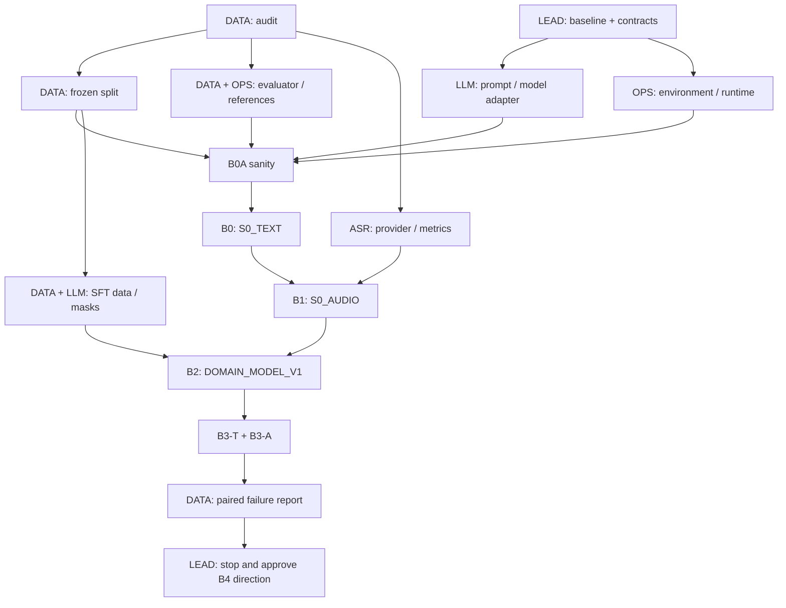

**LifeMate — Project plan dựa trên khảo sát thực tế**

Ngày khảo sát: **03/11/2026, GMT+7**. Trạng thái: **planning/investigation; chưa triển khai solution, chưa chạy neural baseline, chưa fine-tune**.

Tài liệu phân biệt bốn loại thông tin: **đã kiểm tra local**, **code/tài liệu upstream đã đọc**, **thiết kế đề xuất**, và **chưa kiểm chứng bằng GPU**. Các con số chất lượng của repo khác không phải kết quả của đội.

**01. Quyết định cho giai đoạn nền tảng — [LEAD]**

- **PRIMARY_BASELINE:** `Qwen/Qwen3-4B-Instruct-2507` + template/parser function calling của **Qwen-Agent** + adapter mỏng cho official `ToolEnv`. Model chạy local; framework không được tự mở thêm công cụ/dịch vụ. ASR cố định cho B1/B3-A là `vinai/PhoWhisper-small` nguyên bản.
- **FALLBACK_BASELINE:** **cùng checkpoint Qwen3-4B**, cùng biểu diễn messages/tool schemas và cùng runtime, nhưng backend trực tiếp Hugging Face Transformers với controller một bước; tái sử dụng parser/template đã được cấp phép. Dùng nếu tích hợp framework/local serving không qua B0A. Chốt fallback trước B0; không đổi giữa bốn phép đo.
- **BASE_MODEL:** checkpoint gốc, không dùng LoRA LifeMate của đội khác. **DOMAIN_MODEL_V1:** adapter LoRA/QLoRA do đội train chỉ trên TRAIN_FIT đã đóng băng.
- Qwen3.5, Spark, NeoHorse và Nanbeige là các ứng viên được khảo sát ở Phase 0, **chưa đưa vào một cuộc chạy đua mô hình trước khi có bốn số đo bắt buộc**. Việc chọn Qwen3 ở đây ưu tiên độ gần các baseline LifeMate, native tool interface, triển khai/fine-tune dễ kiểm soát và license rõ; không khẳng định Qwen3 mạnh nhất.
- So với gợi ý Spark trước đó, đây là quyết định theo tiêu chí mới của yêu cầu: **giảm công sức thích nghi và giữ nền thí nghiệm sạch**. Spark vẫn là challenger chất lượng sau gate B3, hoặc chỉ được thay làm baseline nếu có lý do kỹ thuật được [LEAD] ghi nhận trước freeze.
- Thứ tự khóa: `audit → split/evaluator/contracts → B0A → B0 → B1 → B2 → B3-T/B3-A → LEAD gate`. Không thêm RAG, router, guard sửa ngữ nghĩa, ASR fine-tune, ensemble, RL hoặc synthetic data trước gate.

**02. Repository audit: những gì thực sự có — [DATA], [OPS]**

Workspace: `D:\Desktop\workspace\competition\2026\ZAIC`. Không phải Git repository tại thời điểm kiểm tra (`git rev-parse` trả về not a git repository). Chưa có source code, baseline, model weights, script chạy, evaluator, requirements, lockfile hay Dockerfile của đội.

```text
ZAIC/
├── DataMate/
│   ├── train.zip                    128,118,095 bytes
│   └── public_test.zip               64,149,714 bytes
└── LifeMate/
    └── train+public_test.zip        876,430,231 bytes
```

DataMate nằm ngoài phạm vi kế hoạch. Chưa giải nén hay sửa ZIP; khảo sát đọc trực tiếp archive. File kế hoạch này là đầu ra tài liệu mới.

Môi trường local được kiểm tra bằng inventory/package metadata, không chạy model:

| Hạng mục | Thực tế | Hệ quả |
|---|---|---|
| OS / Python | Windows 11; Python 3.13.13 | Không lấy làm môi trường Linux submission hoặc Kaggle training |
| GPU | RTX 4060 Laptop, 8,188 MiB; driver 616.56 | Chỉ có thể kỳ vọng smoke/quantized inference sau khi setup riêng; chưa đo |
| PyTorch | **2.12.0+cpu** | Có GPU vật lý không có nghĩa PyTorch hiện dùng CUDA được |
| Transformers | 5.12.1 | Chưa có compatibility smoke với training stack |
| PEFT / TRL / bitsandbytes / vLLM / soundfile | Không tìm thấy | B2 và audio/GPU runner chưa sẵn sàng |
| numpy / scipy / jsonschema / sklearn | Có | Hữu ích cho audit; không phải lockfile tái lập |

**MUST HAVE [OPS]:** tạo môi trường project biệt lập sau khi bắt đầu implementation; không thay Python/global packages hiện tại. Linux/Python 3.11 là mục tiêu ban đầu. Khóa phiên bản sau smoke thực tế, không tuyên bố stack hiện tại đã tương thích.

**03. Cấu trúc chính xác của dữ liệu — [DATA]**

Trong archive có một lớp thư mục `train+public_test/`:

```text
train+public_test/
├── README.md
├── VERSION
├── train/
│   ├── train.jsonl
│   ├── train_tools_catalog.json
│   ├── train_environment/<id>/state.json
│   ├── audio/<id>/<id>.wav
│   ├── audio/<id>/<id>_u1.wav, ...
│   └── zaic_tools/
│       ├── __init__.py
│       ├── __main__.py
│       ├── executor.py
│       ├── utils.py
│       ├── validate.py
│       ├── README.md
│       └── apps/*.py
└── public_test/
    ├── public_test.jsonl
    ├── public_test_tools_catalog.json
    ├── sample_submission.jsonl
    ├── public_test_environment/<id>/state.json
    ├── audio/<id>/<id>.wav
    ├── audio/<id>/<id>_u1.wav, ...
    └── zaic_tools/                  runtime riêng cho split này
```

`VERSION`: `release: v3.2.0`; `built: 2026-10-24T23:35:25+0700`; `train 1545 / public_test 634`. Catalog cả hai split có `schema_version: 2.7.0`.

Archive có 22.885 file entries; sau khi bỏ AppleDouble `__MACOSX/`/`._*` còn 9.258 file. Có `.DS_Store` và metadata macOS; đây không phải mẫu học. Tổng file thực chưa nén 1.130.963.875 bytes; gồm 6.969 WAV, 2.181 JSON, 98 Python, 3 JSONL, 3 Markdown và 4 file không extension. Không coi số entries thô là số audio.

Schema một dòng train, đã kiểm tra trên dữ liệu:

| Trường thật | Cấu trúc / cách dùng |
|---|---|
| `id` | ID duy nhất trong train; tên sample/session/output |
| `audio` | Đường dẫn tương đối audio lượt hiện tại |
| `audio_text` | Transcript chuẩn lượt hiện tại; chỉ train |
| `context.current_time`, `.timezone` | Thời gian tham chiếu; toàn train có timezone `Asia/Ho_Chi_Minh` |
| `context.location` | `lat`, `lng`; không giả định đây là địa chỉ văn bản |
| `context.user_profile` | Các key quan sát: `name`, `home_address`, `work_address`, `city` |
| `context.installed_apps` | Map app → `{tools: [tool_name, ...]}`; không chứa state để agent đọc trực tiếp |
| `history` user | `role`, `audio`, `audio_text` ở train; public không có `audio_text` |
| `history` assistant | `role`, `text`; có thể thêm `tool_calls`, và có thể thêm `tool_results` |
| `label.tool_calls` | Danh sách `{name, arguments}` đúng cho **lượt cuối** |
| `label.tool_results` | Kết quả tương ứng từng call; số phần tử khớp mọi mẫu train |
| `label.final_state` | Toàn bộ state của những app được ghi trong nhãn; **không phải toàn môi trường** |

Public chỉ có `id`, `audio`, `context`, `history`; không có label hoặc transcript chuẩn, kể cả trong user history. Train **không có `label.state_hash`**. Không được tự chế ra trường này trong loader; reference hash phải được dựng bởi evaluator train-only.

Catalog thật: `schema_version`, `note`, `apps[]`; mỗi app có `id`, `name_vi`, `group`, `description`, `tools[]`. Tool có `name`, `kind`, `description`, `parameters`, `returns`, `app`. Giữ cả `required`, `enum`, range/format, `items`, `x-one-of`, `x-ref`, `x-match: fuzzy`. Có 77 tool train với `returns` rỗng; không giả định mọi tool đã có output schema đầy đủ.

**04. Thống kê đã đo và những gì cần thu tiếp — [DATA], [ASR]**

| Chỉ số | Train | Public test — chỉ khảo sát cấu trúc |
|---|---:|---:|
| Mẫu | 1.545 | 634 |
| Audio lượt hiện tại | 1.545 | 634 |
| Audio user history | 3.491 | 1.299 |
| Tổng WAV | 5.036 | 1.933 |
| Tổng giờ audio | 6,829 | 2,762 |
| Median audio hiện tại | 6,936 s | 7,209 s |
| P95 audio hiện tại | 11,838 s | 13,472 s |
| Max audio hiện tại | 22,334 s | 20,237 s |
| Median tổng audio/sample | 12,995 s | 12,719 s |
| P95 tổng audio/sample | 41,081 s | 39,633 s |
| Max tổng audio/sample | 69,412 s | 82,829 s |
| Catalog apps, gồm sys | 46 | 36 |
| Catalog tools | 147 | 122 |
| Tool khả dụng/sample, chưa cộng sys nếu không liệt kê | min 8, median 31, max 62 | min 10, median 30, max 59 |

Tất cả WAV đọc được header 16 kHz, mono, 16-bit PCM; không có audio reference bị thiếu hoặc WAV không được reference. Đây là **kiểm tra header/path**, không thay thế nghe mẫu hoặc kiểm tra tín hiệu clipping/silence/corruption toàn waveform.

Train: 62 read / 84 write / 1 meta tool. Tổng 3.541 gold calls: 1.599 read / 1.725 write / 217 meta. Pure schema validation bằng `validate.py` official: **0 lỗi / 3.541 calls**; chưa thực hiện gold replay toàn bộ hoặc kiểm tra state consistency.

| Số gold calls | 0 | 1 | 2 | 3 | 4 | 5 | 6 |
|---|---:|---:|---:|---:|---:|---:|---:|
| Số mẫu | 111 | 369 | 428 | 359 | 161 | 107 | 10 |

1.065 mẫu có ≥2 calls (~68,9%). 217 mẫu có ask; 157 trong số đó đã gọi tool khác trước ask. Ask là lệnh cuối ở cả 217 mẫu. 1.018 mẫu có history (~65,9%); max 24 lượt. Có **397 assistant history turns có calls nhưng không có results**: giữ thông tin hiện có, không dựng kết quả giả, không replay history.

`label.final_state` có 0/1/2/3 app ở lần lượt 373/849/283/40 mẫu. **373 nhãn state rỗng không đồng nghĩa 373 mẫu ngoài phạm vi**; nhiều mẫu chỉ đọc hoặc không làm thay đổi state. Tương tự, 111 gold-call rỗng chỉ là nhóm zero-action; cần phân loại thêm bằng yêu cầu và tool availability.

Train/public chung 88 tools, parameter schema của tools chung không đổi. Public có **34 tools mới thuộc 11 apps**: `ecommerce`, `event_tickets`, `grocery`, `habit_tracker`, `pantry`, `parking`, `public_transit`, `recipes`, `stocks`, `train_bus_tickets`, `translator`. Chỉ dùng kết luận cấu trúc này để nhận thức yêu cầu generalization; không tạo nhãn hoặc huấn luyện từ câu hỏi test.

Train catalog có 68 vị trí `x-ref`, 40 vị trí `x-match: fuzzy`, 6 tools có `x-one-of`. Gold dùng 146/147 tools; `contacts.get` chưa xuất hiện trong gold. Không bỏ tool này khỏi schema chỉ vì chưa có nhãn.

**MUST HAVE cần thu tiếp trước freeze:** [DATA] độ dài token chính xác bằng tokenizer/prompt đã chọn, cả prefix và target ở mỗi bước; tỷ lệ overflow; phân phối app/task/chain/history; loại phụ thuộc ID; schema coverage; duplicate/near-duplicate và nhóm kịch bản; [ASR] silence/clipping, utterance length, số tiền/ngày/giờ/tên riêng, code-switching và audio quality. Không tự suy ra accent/speaker/gender label: không có trường đó trong schema đã thấy.

**SHOULD HAVE:** phân bố theo chuỗi tool và write/read pattern, cross-app chains, schema-return sizes, rare entities, ambiguity/negative cases; log tất cả denominator và cách gán nhãn. Task tags từ regex chỉ là weak labels, phải kiểm tra mẫu thủ công trên train.

**05. Những khác biệt tài liệu/implementation phải xử lý — [DATA], [OPS], [LEAD]**

| Phát hiện | Hệ quả / quyết định |
|---|---|
| README có ví dụ `get_state()`; Rule hiện hành cấm nó ở inference | Agent chỉ nhận `validate`, `call`, `get_tool_calls`, `get_state_hash`. `get_state()` chỉ ở evaluator train-only; không truyền snapshot vào prompt |
| Không có scorer fuzzy đầy đủ trong ZIP | `__main__.py --validate` chỉ kiểm schema; không công bố điểm đó là official score |
| `utils.py` train/public **khác nhau** | Không dùng một module đã import của train cho public. Pin/import đúng runtime theo split, tốt nhất mỗi split trong process riêng |
| `LIVE_APPS` train có exchange_rate/lottery; public không có | Hash phải gọi runtime của split, không hard-code danh sách apps bỏ qua |
| `FREE_TEXT_KEYS`: train có `expression`; public thay bằng `text` | Không tự hash `label.final_state` hoặc sao chép canon của train sang public |
| Schema-valid nhưng ID không tồn tại / số dư thiếu trả `ok=true, done=false` | Agent phải đọc `done`/message/danh sách trả về, không xem `ok` là task success |
| Web minh họa dùng `ride.book`; catalog thật dùng `ride_hailing.book` | Tên lệnh từ catalog của split là authoritative cho inference |
| `final_state` chỉ là một phần môi trường, không có gold hash | Xây reference từ runtime/train labels; không hash riêng map này |
| Community AIO evaluator ghi rõ exact-call diagnostic | Không lấy làm official-compatible fuzzy scorer |
| Community tlee fuzzy mọi string, ngưỡng 0,85 | Khác rule chỉ fuzzy field đánh dấu, token-F1 >0,6; greedy matching cũng có thể thiếu tối đa matches |
| FAQ/lịch có các bản ghi khác nhau; private release 09:00 vs 11:00 | Theo dõi BTC; không suy đoán giờ cuối. Deadline Docker 16/11 23:59 là mốc thiết kế |
| Kaggle docs chung còn P100, thông báo staff nói nghỉ 15/09/2026 | Kế hoạch 03/11 dùng T4x2; không xây kế hoạch dựa trên P100 |

Rule hiện hành: LLM <5B; tổng ASR+LLM+thành phần khác <6B; context ≤16.384; ≤30 s/sample trên A30 + Xeon Gold 6442Y 16-core + RAM 64 GB; inference offline. Có thể tạo synthetic khi phát triển, không gán nhãn test để train/tune. Một ToolEnv/sample, mọi executed call vào submission. [Rule chính thức](https://challenge.zalo.ai/portal/lifemate).

**06. Phase 0: baseline discovery thực sự đã làm — [LEAD], [LLM], [OPS]**

Đã kiểm tra cộng đồng LifeMate **trước** khi chọn generic framework. GitHub metadata/tree và các file agent/evaluator/integration/verification được đọc tĩnh, không cài hoặc chạy code repo. `license: null` và không tìm thấy LICENSE trong tree kiểm tra nghĩa là **chưa xác định quyền tái sử dụng**, không phải kết luận tác giả cấm mọi sử dụng. Hiện chỉ tham khảo thiết kế; không copy source vào solution.

| ID / nguồn | Model & domain | Bằng chứng được đọc | Kết luận Phase 0 |
|---|---|---|---|
| C1 [Neeze](https://huggingface.co/Neeze/lifemate-zac2026) | PhoWhisper-large FT + Qwen3-4B LoRA; ~5,57B theo tác giả | README, tree, các đoạn core loop/guard; dev 61,52, public 49,03 do tác giả báo | Gần domain nhất có weights + measured claims; **không dùng nguyên gói**: `license: other`, release 01/11, all-train adapter không sạch với split đội; guard/few-shot làm mất zero-shot control; A30 mới ước lượng |
| C2 [AIO-Dewey](https://github.com/AIVIETNAM-AIO-Dewey/Zalo-AIC-2026-Lifemate) | Text Qwen3-4B | `agent.py`, `evaluate.py`, README | Single-step/native tool scaffold gần yêu cầu; evaluator exact-only và chưa GPU-score; chưa có license rõ |
| C3 [MrPickle](https://github.com/MrPickle200/zalo-ai-2026-lifemate) | Whisper/PhoASR + Qwen3-4B | agent, progress, insights | Có split/error experiments; public ~9,79 theo nhật ký. Proxy không official; repair có nhánh trả stop, request timeout 180 s. Không chọn vì tên repo/domain; chưa có license rõ |
| C4 [lenamkhanhh](https://github.com/lenamkhanhh/ZaloAIC) | Harness cắm ASR/LLM tự cung cấp | README + INTEGRATION | Reuse boundary tốt, có manifest; JSON bridge/prompt mismatch phải sửa. Chỉ smoke model gốc, chưa chất lượng FT; chưa có license rõ |
| C5 [trtkiet](https://github.com/trtkiet/zalo-ai-challenge) | Gipformer + SEA-LION, LoRA/QLoRA toolkit | README + VERIFICATION | Training plumbing gần domain; verification thừa nhận GPU/VRAM/A30 chưa đo. Next-step metric không task score; chưa có license rõ |
| C6 [AIO-tlee](https://github.com/AIVIETNAM-AIO-tlee/ZAIC2026-LifeMate) | Whisper-small + agent adapter | README + agent_metrics | Hữu ích tham khảo audio runner, nhưng fuzzy scorer khác BTC; chưa có license rõ |
| P0 [Qwen-Agent](https://github.com/QwenLM/Qwen-Agent) + Qwen3-4B | Official tool-calling scaffold/model | Apache-2.0; `fncall_agent.py`, setup, model card | **PRIMARY**: tái sử dụng licensed tool-call representation/parser; cần adapter ToolEnv và deadline wrapper |
| P1 [Transformers](https://github.com/huggingface/transformers) + cùng Qwen3-4B | Model-native generation | Apache-2.0; cùng model/template | **FALLBACK**: ít dependency orchestration; phải tự làm controller mỏng, parser không đổi ngữ nghĩa |

Ma trận năng lực: **D** = có code/tài liệu hỗ trợ, chưa đội chạy; **V** = phải xác minh; **N/A** = repo không cung cấp model/pipeline đó.

| Candidate | Tiếng Việt | Tool / JSON | Multi-step / history | Schema LifeMate | LoRA/QLoRA | Kaggle / local | Thích nghi và reuse |
|---|---|---|---|---|---|---|---|
| C1 | D, đúng task | D / D | D / D | D | Adapter có sẵn; sạch split V | A100 theo tác giả / V | Nhiều code gần task nhưng chưa rõ reuse rights, không zero-shot |
| C2 | D ở prompt; quality V | D / native blocks | D / D | Gần nguyên schema | Chưa có kết quả | V / V | Mỏng, dễ tham khảo; source reuse chưa được xác lập |
| C3 | D; ASR lỗi được ghi | D / custom JSON | D / D | Có schema compaction, cần audit extension | Training scripts; gain chưa chứng minh | V / có self-reported runs | Khá nhiều code; latency/repair/proxy phải sửa |
| C4 | Phụ thuộc checkpoint | D / một dict mỗi bước | D / D | Có adapter | Người tích hợp tự nạp | V / smoke self-reported | Runtime có thể tách; bridge native format là công việc thật |
| C5 | SEA-LION/ASR hướng Việt | D / D | D / D | Có extension bridge | D, GPU chưa xác minh | V / chưa GPU verified | Training/ops nhiều; complexity vượt nhu cầu B0 |
| C6 | ASR Việt là mục tiêu | D / D | D / D | Adapter cần kiểm | Script có, quality V | V / V | Tham khảo audio, không reuse scorer hiện tại |
| P0 | Model đa ngôn ngữ; Việt V | D / native function call | D / D | Bridge bắt buộc giữ extensions | Standard HF+PEFT | V / local quantized V | Tái sử dụng template/parser/LLM interface; không dùng web/RAG/file tools |
| P1 | Như P0 | D / cùng format | Controller + history do đội làm | Giữ schema gốc | Standard HF+PEFT | V / quantized V | Reuse model/template/parser; thêm loop tối thiểu |

Runtime tất cả candidates **chưa được đội xác nhận trên A30**. CPU tests hoặc dự đoán số giây không được coi là bằng chứng đạt 30 s. Lượng code tái sử dụng là theo module có thể dùng, không ước lượng phần trăm không có cơ sở.

Vì cộng đồng gần task nhất đang thiếu license rõ hoặc trộn FT/guard/proxy, chọn P0 có lý do kỹ thuật và quyền sử dụng cụ thể. Đây vẫn là **adapt một framework tool calling có sẵn**, không tự xây một generic agent framework. Nếu quyền dùng một community implementation được xác lập trước B0A, [LEAD] có thể đổi lựa chọn sau audit; phải ghi decision record và freeze trước B0.

**07. Model candidates và revision — [LLM], [ASR], [LEAD]**

| Model | Số tham số checkpoint được metadata báo | License | Vai trò |
|---|---:|---|---|
| [Qwen3-4B-Instruct-2507](https://huggingface.co/Qwen/Qwen3-4B-Instruct-2507) | 4.022.468.096 | Apache-2.0 | BASE_MODEL; non-thinking native; HF/PEFT standard |
| [Spark-X2.5-4B](https://huggingface.co/XHToken/Spark-X2.5-4B) | 4.112.079.360 | Apache-2.0 | Challenger sau gate; custom architecture/parser, benchmark thinking không tương đương cấu hình thi |
| [NeoHorse-1-4B](https://huggingface.co/TokenRhythm/NeoHorse-1-4B) | 4.205.751.296 | Apache-2.0 | Challenger agentic text-only; runtime/Vi/QLoRA V |
| [Qwen3.5-4B](https://huggingface.co/Qwen/Qwen3.5-4B) | 4.659.865.088, checkpoint đầy đủ | Apache-2.0 | Challenger; phải kiểm kiến trúc/masking/memory khi FT |
| [Nanbeige4.2-3B](https://huggingface.co/Nanbeige/Nanbeige4.2-3B) | 4.169.800.704, không phải tổng 3B | Apache-2.0 | Challenger; custom/looped architecture, Vi chưa được xác minh |
| [PhoWhisper-small](https://huggingface.co/vinai/PhoWhisper-small) | ~244M theo tác giả | BSD-3-Clause | ASR baseline cố định B1/B3-A, inference-only |
| [Gipformer1.5-68M](https://huggingface.co/g-group-ai-lab/gipformer1.5-68M-rnnt) | ~68M theo tác giả | MIT | ASR challenger sau gate; ONNX nhanh là giả thuyết phải đo |

Các checkpoint gốc trên đều có repository metadata trước cutoff; ngày repository không tự chứng minh mọi revision được phát hành cùng ngày. Lưu commit/weight hashes và lịch sử phát hành trước dùng. Không lựa chọn LoRA LifeMate công bố sau cutoff khi chưa giải quyết provenance/rule và split contamination.

Revision mục tiêu của BASE_MODEL: `cdbee75f17c01a7cc42f958dc650907174af0554`; PhoWhisper-small: `a86b604c346caf7148c37512eafe783a16420adb`. Qwen-Agent source đã kiểm tra: `31a4d36d123688581a9e9744427272b33ce940e0`; [OPS] xác minh license/dependency của revision này và đóng gói snapshot đã duyệt, không `pip install latest` khi chấm.

Tổng baseline khoảng 4,266B trước adapter. LoRA r16 toàn bộ attention/MLP của Qwen3 dự kiến thêm khoảng 33M, cần đếm thật; tổng vẫn có margin. Đếm logical parameters từ kiến trúc/trọng số chưa pack, không lấy số phần tử tensor packed 4-bit làm số tham số. Không ensemble hai LLM trong baseline. Mô hình context lớn vẫn phải cấu hình ≤16.384.

**08. Task taxonomy đa nhãn — [DATA] thiết kế, [LEAD] duyệt**

Không ép mỗi sample vào đúng một category. Gán các trục độc lập bằng dữ liệu train:

| Trục | Tags đề xuất / cách lấy |
|---|---|
| Độ dài hành động | zero / one / 2–3 / 4–6 gold calls |
| Tác động | read-only / write / mixed / ask-only / calls-before-ask; dựa `kind` |
| Domain | `app.group`, app names từ gold; cross-app nếu >1 namespace ngoài sys |
| Dependency | resolve ID, read-before-write, result-to-argument, chained creation, multiple matches |
| Logic ngôn ngữ | conditional, negation, conjunction, correction, relative time; weak label + audit |
| History | none / short / long; reference-to-history / topic-switch; không suy từ length rằng chắc có coreference |
| Missing info | absent value / ambiguous entity / lookup empty / unsupported; đọc text + tool results |
| ASR-critical | money / time / date / phone / address / contact / English term |
| Schema complexity | x-ref / x-one-of / enum / nested array/object / fuzzy field |
| Zero action | unsupported / condition false / no-op / other; 111 mẫu không tự động coi là OOS |

Ví dụ đã đọc: `train_0001` weather→calendar→contact→SMS, conditional + relative time + entity grounding; `train_0025` hủy lịch rồi ask do hai liên hệ Minh; `train_0069` history dài, điều khiển đèn rồi ask liên hệ. Không dùng ví dụ train làm few-shot trong B0/B1.

**09. Validation và leakage — [DATA], phụ thuộc audit; [LEAD] freeze**

Mục tiêu khoảng 80/20 (**~1.236 TRAIN_FIT / ~309 VAL_MAIN**), số cuối điều chỉnh theo group, không phá group để đạt đúng 309. Đây là kế hoạch, **chưa tạo split**. Seed dự kiến `20261103`, manifest version `split-v1`.

Quy trình MUST HAVE:

1. Group toàn bộ một sample/conversation cùng tất cả audio hiện tại/history và mọi timestep sinh ra. Split ở cấp conversation **trước** SFT expansion.
2. Group duplicate transcript/dialogue chính xác sau NFC/lowercase/whitespace. Đã thấy `train_0061` và `train_0066` phải cùng partition.
3. Quét near-duplicate yêu cầu/kịch bản bằng character shingles và tool skeleton; ngưỡng là quyết định train-only được ghi lại, không tối ưu bằng public score.
4. Quét audio checksum/near-audio và shared history. Đã thấy 58 history strings lặp giữa các mẫu, liên quan 117 samples, max frequency 6. Một câu chào chung không đủ gộp mọi kịch bản; group exact full dialogue/audio clone, còn shared generic utterance chỉ báo cáo overlap. Khi thiếu speaker IDs, không tuyên bố speaker-disjoint.
5. Group-aware stratification theo call length, ask, zero-action, history bins, domain. Xem connected-component sizes trước; báo largest group và deviations.
6. Trong VAL_MAIN gắn một **schema-generalization slice** bằng lựa chọn train-only: giữ lại vài app/chain đủ hiếm theo quy tắc định trước và không đưa gold behavior của chúng vào TRAIN_FIT. Ghi tool-disjoint theo gold, không ngộ nhận installed distractors là training exposure. Nếu grouping làm slice quá nhỏ/lệch, báo chưa đủ evidence và để rigorous domain split cho B4; không âm thầm tạo một training experiment thứ hai.
7. Freeze IDs, rules, seed, hashes, tags, tokenizer/rendering decision. B0/B1/B3 dùng đúng cùng manifest. Không drop sample lỗi/overflow/timeout khỏi denominator.

Leakage inventory: gold `audio_text` lọt B1; train `label`/`final_state` lọt agent; history gold transcript lọt test-like inference; split sau timestep expansion; few-shot/retrieval lấy VAL_MAIN; synthetic hoặc rules từ validation; ASR fine-tune thấy audio dev; tokenizer/data caches dùng chung sai source; all-train community adapters đã thấy dev; chọn checkpoint bằng public answers; resume dùng artifacts khác model/config; hidden direct reads environment; dùng ID làm key để dự đoán lệnh. Tất cả phải có checks và provenance.

**SHOULD HAVE:** giữ một sealed holdout train-only nhỏ để xác nhận cuối sau B3 nếu đủ sample budget; chốt trước training và không dùng chọn epoch. Không hứa có hai holdout đủ mạnh khi chưa đo group/rare-family counts.

**10. Evaluation strategy — [DATA] owner, [OPS] runtime boundary**

Không có official full fuzzy scorer trong ZIP. Xây **spec-aligned local evaluator, chưa được BTC chứng nhận**, dùng runtime/canon official. Nếu BTC cung cấp scorer sau, pin và đối chiếu; không lặng lẽ đổi số đo cũ.

Reference train-only:

- Dùng runtime train để tạo gold reference trong job annotation riêng; mỗi reference replay tạo một session, chạy gold calls đúng thứ tự; không dùng `Executor`/clone làm agent.
- Kiểm tra các app có trong `label.final_state` khớp replay. App khác phải giữ trạng thái dự kiến; reference hash là **hash đầy đủ từ gold session**, không hash partial map.
- `get_state()` chỉ được evaluator train-only dùng để chứng minh consistency. Agent process không được chạm ground truth hoặc state snapshot.
- Gold reference job và model inference là hai hoạt động train-only tách biệt; không reset/retry agent session, không tạo shadow env để agent thử lệnh.
- Khi đánh giá model, dùng executed calls/hash từ session thật; đối chiếu replay/instrumentation trong evaluator riêng nếu cần, không để kết quả gold hay sửa lỗi oracle quay lại agent.

Tool matching theo [Evaluation](https://challenge.zalo.ai/portal/lifemate): cùng tool name; non-fuzzy arguments exact; chỉ những field `x-match: fuzzy` dùng token-F1 >0,6 sau lowercase/NFC. Tạo graph các cặp hợp lệ và maximum-cardinality bipartite matching, không greedy hoặc set làm mất multiplicity. Với M matches, U unmatched predicted và G gold: P=M/(M+U), R=M/|G|; nonempty gold có score 0 nếu hash sai hoặc M=0, còn lại F1; macro average nhân 100. Gold rỗng có special rule pred rỗng=1, ngược lại 0. Executed schema-rejected calls vẫn là unmatched calls; proposals chưa execute không được chèn vào submission.

Các điểm BTC chưa mô tả đủ phải là scorer assumptions có version: tokenizer/punctuation của token-F1, empty fuzzy strings, optional/excess argument keys, tie matching. Không dùng generic edit-distance 0,85 cho tất cả strings. Test ranh giới **=0,6 phải fail**, >0,6 pass. Timeout/execution failure tính 0 theo rule runtime. Báo hash reproducibility và submission validity riêng; precedence của empty-gold/hash-invalid phải được hỏi BTC nếu cần, không gọi local assumption là official.

Metrics và denominator phải rõ:

| Metric | Định nghĩa kế hoạch |
|---|---|
| `score_spec_local` | Macro 0–100 của công thức trên, scorer version/assumptions kèm theo |
| `final_state_accuracy` | Tỷ lệ hash thực thi cuối khớp reference đầy đủ, trên toàn frozen N |
| `tool_f1` | Macro F1 matching theo schema; bổ sung strict exact-call F1 để chẩn đoán |
| `argument_accuracy` | Align name-only bằng matching được mô tả; tỷ lệ aligned calls có toàn bộ args đúng; kèm aligned-call coverage để không che missing tools |
| `argument_slot_accuracy` | Chẩn đoán field-level strict/fuzzy riêng; không thay official-like score |
| `sequence_exact_match` | Diagnostic có thứ tự; không nhầm với F1 không xét thứ tự |
| `schema_valid_proposal_rate` | Trước execute; tách khỏi rejection rate của executed calls |
| `ask`, `zero-action` P/R/F1 | Dựa reference, báo FP/FN; không gán tất cả zero-call là OOS |
| `latency` | Wall-clock/sample; ASR, normalization, prompt, LLM prefill/decode, validation, env, serialization; p50/p95/max và >30 s |

Meaningful evaluator checks MUST HAVE: gold replay score 100 trên audited references trừ mismatch được điều tra; wrong ID/state=0; duplicate predictions không match lại một gold; many-to-many fuzzy cần maximum matching; calls sai schema được tính; failed action `ok=true,done=false`; zero-gold special case; full vs partial state; runtime split mismatch; missing/duplicate/unknown submission ID; timeout không được điểm từ early-stop. Không viết test chỉ lặp lại implementation.

Lưu actual final states chỉ cho train validation trong evaluator-private artifacts. Public/private submission runner chỉ xuất calls/hash, không gọi `get_state()` để satisfy logging. Không đánh đổi rule inference để có một log field.

**11. Contract chung trước B0A — [OPS], [LLM], [ASR], [DATA]**

Đây là interface **đề xuất**, không phải trường được cho là đã có trong official JSONL:

| Interface | Input → output | Owner |
|---|---|---|
| Transcript provider | split/sample audio refs → mapping audio path→text, model/hash/source/latency | [ASR] |
| Prompt builder | latest transcript + context + history transcripts/assistant data + allowed schemas → messages/tools | [LLM] |
| Model backend | messages/tools + deadline/output budget → raw output + usage + proposed calls/finish | [LLM] + [OPS] |
| Runtime bridge | valid proposed call → `env.validate` → at most one `env.call` → observation | [OPS] |
| Evaluator | prediction + train-only reference → metrics, final-state checks, error evidence | [DATA] |

B0 history user dùng gold transcript; B1 thay **mọi** user audio current/history bằng cùng ASR, không fallback `audio_text`. Giữ nguyên assistant history/calls/results hiện có, không chạy lại. Missing historical results không được tự hoàn thiện bằng gold/replay.

Giữ namespace/tool names và parameter schema gốc, kể cả x-one-of/x-ref. `sys.ask_missing_info` luôn có. Toàn bộ installed tools vào baseline; không retrieval/shortlist. History trình bày theo thời gian, cùng serialization cho train/inference. Latest input phải được chỉ rõ, dùng `context.current_time` thay system date.

Qwen-Agent default loop không tự có deadline 30 s hoặc semantics ask-stop của LifeMate. Adapter phải kiểm soát từng call, stop sau executed ask, không parallel execution, không default web/code/file tools, không Memory/RAG files/cloud model. Dùng local model transport; module SDK tên OpenAI không đồng nghĩa gọi API thương mại. Chỉ adapter/parser metadata đi vào agent, không environment path/nội dung.

Parser giữ raw output; không `eval`, không sửa ngữ nghĩa bằng heuristic, không biến parse failure thành DONE sạch. Native transport được B0A kiểm tra và freeze; không bắt model xuất một JSON grammar khác với format đã train mà không đo. Ghi rõ proposal và executed-call lists khác nhau.

Giới hạn dự kiến trước B0A: tối đa 8 executed calls/sample (guard thí nghiệm, **không phải giới hạn official**), tối đa 2 local parse/schema repairs tổng, output cap ban đầu 512 token/bước, total context ≤16.384 gồm output reserve. Có deadline monotonic cho **toàn sample** từ audio I/O đến ghi kết quả; chặn call đến muộn, không chỉ đặt timeout riêng HTTP. Không coi 25 s agent + thời gian ASR là 30 s end-to-end. Chốt limits sau smoke, sau đó freeze B0–B3.

**12. B0A — Baseline sanity inference — [OPS] + [LLM], evaluator [DATA]**

Dependency: split/evaluator/reference tests + license/model revision + parser contract + môi trường GPU smoke.

Chọn 12–20 mẫu **TRAIN_FIT** bằng taxonomy, không dùng VAL_MAIN để chỉnh prompt: zero-action, one call, chain, ask-only, lookup→ask, partial-write→ask, long history, x-one-of, datetime, ambiguous contact. Giai đoạn đầu dùng gold text, không ASR.

Kiểm tra: model load/generate; template/tool schema compatibility; parse; validate không execute; live observation phản hồi đúng; một ToolEnv/sample; submission lấy nguyên env; evaluator chạy; deadline/termination; error/raw trace đủ; tách model khỏi labels/state. Dùng short pilot để đo actual token lengths và peak VRAM; chưa tối ưu score.

**Done:** mọi sample có một output hoặc failure rõ, không silently skipped; không hidden reset/history replay; evaluator có references hợp lệ; format/parser success và failure taxonomy có số liệu; raw artifacts và config tái chạy được. Không bắt B0A đạt điểm chất lượng tùy ý. Nếu đổi prompt/format/backend để sửa compatibility, version lại trước freeze.

**13. B0 — Text-only zero-shot — [LLM], [OPS], [DATA]**

Input: gold current/history transcripts + context + assistant history + available schemas; không examples/few-shot, không adapter, không oracle hints. Chạy toàn VAL_MAIN, cùng one-step execution semantics đã chốt. Không tiếp tục sửa prompt giữa các sample.

Inference representation, quantization/dtype, tokenizer, seed, backend, schema ordering, context/output budget, max calls/repairs và stopping policy được freeze. Đề xuất dùng cùng NF4 inference base cho B0/B3 nếu đó là stack đã qua smoke và phù hợp Kaggle; nếu chọn FP16 thì giữ FP16 cho cả hai. Không đổi base quantization khi bật adapter để rồi gọi toàn bộ delta là hiệu quả SFT.

Lưu `S0_TEXT`, raw outputs, parsed proposals, every executed call/result, state hash, train-only final states ở evaluator, per-sample scores, latency, errors, stop reason. Pilot để kiểm compute không biến thành vòng search prompt trên dev.

**Done:** đủ N mẫu hoặc N failure records; metrics theo toàn denominator, repeatability subset có báo cáo; grader/revision/config hashes; không inference gọi `.get_state()`; mọi timing text ghi rõ không bao gồm ASR. Đây là mốc tham chiếu, không yêu cầu đạt ngưỡng score không có evidence.

**14. B1 — Audio zero-shot — [ASR] + [OPS], evaluate [DATA]**

Dependency B0 complete; ASR provider có thể được xây song song trước đó nhưng chỉ ghép sau freeze B0.

Chỉ thay transcript provider. PhoWhisper-small cố định, greedy/deterministic decoding; không domain fine-tune, không sửa tên/tiền/giờ theo gold. Ban đầu normalization bảo toàn nội dung (NFC/whitespace); mọi quy tắc số/giờ bổ sung có thể đổi task phải để B4. Cùng model/prompt/schema/parser/limits với B0; normalization function giống nhau ở mọi chế độ.

Phiên âm cả current/history user audio. Gold nằm evaluator-only. WER là lỗi ở mức token tiếng Việt đã mô tả normalization, không giả định token=word ngôn ngữ học. Report raw WER/CER và entity-sensitive exact/slot errors cho money/time/date/phone/name/address, với cách lấy span và normalization version. Có human audit train-only cho các entity failures khó.

Lưu `S0_AUDIO`. Tái dùng cache chính xác cùng ASR hash để so chất lượng B1/B3-A, nhưng phải có **live uncached end-to-end timing**; quality run dùng cache không được gắn nhãn runtime competition. Không tính tốc độ bằng audio lượt cuối hoặc cache hit.

`S0_TEXT − S0_AUDIO` là paired diagnostic gap do ASR/normalization trong pipeline cố định, không phải phép chứng minh nhân quả tuyệt đối cho mọi failure. B1 có thể tình cờ cao hơn B0 do perturbation; không chặn số âm.

**Done:** transcript coverage 100% current/history hoặc explicit failures; S0_AUDIO và metrics đầy đủ; paired errors/latency có breakdown; không transcript gold fallback.

**15. B2 — Domain SFT / QLoRA — [LLM], data [DATA], Kaggle [OPS]**

Dependency: B0 và B1 artifacts cố định; TRAIN_FIT manifest; target-mask/tokenizer audits. Không fine-tune ASR trong B2.

Data formulation: mỗi sample sinh một prompt cho từng next action bằng latest request/context/schemas/history + **chỉ những observations trước action đó**, và một final target finish. Toàn train có tối đa **5.086 decision examples = 3.541 calls + 1.545 finish**, nhưng B2 chỉ dùng TRAIN_FIT nên số thật nhỏ hơn và phải thống kê. Không dùng nhãn tương lai, gold final_state, hoặc gold return của chính action đang dự đoán. Các bước cùng sample không được tách split. Loss chỉ trên current assistant action/finish, không trên user/system/tool results/assistant history. Dùng đúng message/template/stop representation của B0; không thêm special token mới khi không cần.

QLoRA initial recipe **đề xuất để smoke, chưa phải hyperparameters tối ưu**:

| Knob | Initial setting / policy |
|---|---|
| Base | Qwen3-4B-Instruct-2507 đúng revision BASE_MODEL |
| Quantization training | bitsandbytes 4-bit NF4 + double quantization |
| Compute | FP16 trên T4; không ép BF16 khi phần cứng không hỗ trợ |
| PEFT | prepare_model_for_kbit_training; LoRA r16, alpha32, dropout0,05 |
| Targets | q/k/v/o_proj + gate/up/down_proj; kiểm tra tên module thật, đếm params |
| Batch | microbatch1; gradient accumulation8 (effective8 trên một GPU) |
| Memory | gradient checkpointing; `use_cache=False` khi train; không ASR/vLLM cùng GPU lúc train |
| Optimizer / LR | AdamW phù hợp stack; LR1e-4, warmup0,03, clip1,0, 1 epoch đầu, tối đa2 nếu tiêu chí định trước |
| Sequence | 4.096 token cho memory smoke; full run chọn từ phân phối tokenizer và VRAM, không mặc định cắt ở4K |
| Padding / loss | audited completion/current-assistant mask; pad tokens -100; kiểm EOS/finish |
| Packing | OFF ban đầu; chỉ bật nếu mask/boundaries được chứng minh và freeze trước full B2 |
| Reporting | local artifacts, tắt tự push/tracing chứa dữ liệu; save adapter/tokenizer/config + RNG/optimizer resume |

[PEFT quantization](https://huggingface.co/docs/peft/v0.18.0/developer_guides/quantization) mô tả 4-bit+LoRA và chuẩn bị model k-bit; [TRL SFT](https://huggingface.co/docs/trl/v0.27.1/en/sft_trainer) hỗ trợ completion/assistant-only loss. API option không thay cho mask audit: phải kiểm token labels bằng dữ liệu thật, có nonzero target tokens và không train historical assistant actions.

Không silently truncate target hoặc loại phần lớn history/schema để vừa GPU. Đo retained/excluded samples theo task family; chọn sequence cap đủ coverage. Nếu 16 GB không đủ cho tail: length bucketing, gradient checkpointing và long-sequence single-example path; giảm target-module/rank hoặc đổi cap là một recipe revision được [LEAD] ghi trước training chính. Không giả định hai T4 tự cộng thành32GB; không dùng `device_map=auto` như distributed-training plan.

Train 20–50 optimizer steps smoke trên TRAIN_FIT; kiểm finite loss/gradient, trainable params, checkpoint save/resume, tokenizer parity và reload generation. Không diễn giải train-loss giảm là downstream gain. Save at epoch boundaries; selection rule định trước bằng validation loss/metrics, giữ sealed evaluation nếu được thiết kế. Không chạy nhiều epoch/hyperparameter trials trên VAL_MAIN rồi chỉ báo best.

**Done:** adapter DOMAIN_MODEL_V1 + base SHA + train IDs/hash + template hash + optimizer config; loss curves, token coverage/masks, peak VRAM, training duration, resume/reload evidence. Không công bố S1 trước khi B3 free-running thực sự hoàn tất.

**16. B3 — Fine-tuned inference và bốn số đo — [LLM], [OPS], [DATA]**

B3-T: DOMAIN_MODEL_V1 + gold current/history transcripts → live tools → evaluator = `S1_TEXT`.

B3-A: cùng adapter + **ASR frozen của B1**, cùng normalization/transcript artifacts → live tools → evaluator = `S1_AUDIO`; thêm fresh audio timing run để xác nhận runtime.

Giữ nguyên prompt, schema selection, parser, backend inference, precision/quantization, budgets, repairs, stop policy và runtime. Chỉ thêm adapter. Nếu backend buộc thay vì không load adapter được, B0/B1 phải được rerun trên backend mới; không gọi comparison cũ là controlled experiment.

| Experiment | Transcript source | LLM | FT | Score local | State accuracy | Tool F1 | Argument accuracy + coverage | Latency p50/p95/max |
|---|---|---|---|---|---|---|---|---|
| B0 | Gold current + history | BASE_MODEL | No | **NOT RUN / S0_TEXT** | — | — | — | text-only |
| B1 | Frozen ASR current + history | BASE_MODEL | No | **NOT RUN / S0_AUDIO** | — | — | — | uncached audio |
| B3-T | Gold current + history | DOMAIN_MODEL_V1 | Yes | **NOT RUN / S1_TEXT** | — | — | — | text-only |
| B3-A | Same frozen ASR | DOMAIN_MODEL_V1 | Yes | **NOT RUN / S1_AUDIO** | — | — | — | uncached audio |

Required deltas: S1_TEXT−S0_TEXT (SFT effect); S1_AUDIO−S0_AUDIO (end-to-end effect); S0_TEXT−S0_AUDIO và S1_TEXT−S1_AUDIO (ASR gap trước/sau). Báo paired gains/regressions/ties, task families và confidence intervals, không chỉ một số trung bình.

**Done:** đủ bốn hàng, cùng split/scorer/contracts, artifacts có thể tái tạo; không drop lỗi; no-op adapter/disabled adapter check giúp phát hiện pipeline drift; report thay đổi state/calls của repeat runs. Teacher-forced next-step accuracy chỉ là diagnostic, không thay B3 free-running.

**17. Error-analysis framework và decision gate — [DATA] thực hiện, [LEAD] sở hữu**

Mỗi failure có một primary cause và có thể nhiều secondary tags; lưu evidence và confidence của nhãn, không suy nguyên nhân chỉ từ final score.

| Category | Evidence / phân biệt |
|---|---|
| ASR_ENTITY / ASR_SEMANTIC | Audio/transcript gold vs predicted; paired text success/audio failure; kiểm tên/số/phủ định |
| TOOL_SELECTION | Sai hoặc bỏ tool; tách thiếu app hỗ trợ với sai nhận diện intent |
| ARGUMENT_GENERATION | Đúng tool nhưng sai key/type/enum/giá trị, thời gian tương đối |
| ENTITY_GROUNDING | ID chưa có trong context/history/observation hoặc chọn sai trong danh sách |
| PLANNING_DEPENDENCY | Gọi write trước read, dùng observation sai, bỏ điều kiện, miss subtask |
| HISTORY_REASONING | Sai tham chiếu/correction hoặc replay lại action đã áp dụng |
| MISSING_INFO | Ask thừa, không ask khi mơ hồ/thiếu, sai tool_name/params |
| UNNECESSARY_CALLS | Read/write lặp hoặc không có trong nhiệm vụ; xem state đúng nhưng F1 giảm |
| STRUCTURED_OUTPUT | JSON/native-block parse fail, truncated generation, unknown function |
| EXECUTION_SYSTEM | OOM, server/process fail, import/runtime mismatch, timeout, serialization |
| EVALUATOR_DATA | Gold replay mismatch, scorer ambiguity, invalid reference; không gán cho model |

Statistical comparison: bootstrap **paired per-conversation/group** score differences (đề xuất10.000 resamples, fixed seed) cho 95%CI; không bootstrap timesteps như mẫu độc lập. Rare slice phải ghi n và wide uncertainty; report số mẫu quyết định delta. Không gọi improvement là chắc chắn chỉ vì loss giảm hoặc vài mẫu tốt hơn.

Sau B3 **dừng ở phân tích**. [LEAD] chọn dominant bottleneck dựa bốn runs; rank B4 theo expected score gain / engineering cost / compliance & latency risk. Không có auto-enable component. Decision record gồm evidence, hypothesis, expected affected slices, budget, acceptance/rejection criteria và người duyệt.

Examples LATER, chưa triển khai: ASR entity fine-tune nếu paired evidence lớn; targeted SFT/hard negatives nếu grounding/ask sai; model challenger nếu capacity gap; few-shot/RAG nếu context/selection thật sự giới hạn; constrained decoding nếu parse fail; runtime quantization/backend tuning nếu timeout. Mỗi thay đổi một ablation so cùng frozen reference.

**18. Experiment tracking và reproducibility — [OPS] + [DATA]**

Mỗi run có immutable ID, ví dụ `b0_text_splitv1_qwen3_nf4_r001`. Run manifest ghi Git commit/code snapshot, archive/split/catalog/runtime hashes, base+adapter+ASR revision, tokenizer/template/prompt hash, model logical parameter count, dependency lock/container digest, GPU/driver/CUDA, seed/decoding/precision, budgets, transcript cache source, scorer version và timing mode.

Artifacts đề xuất: `run_manifest.json`, `transcripts.jsonl`, `model_outputs.jsonl`, `proposals.jsonl`, `tool_traces.jsonl`, `submission.jsonl`, `scores.jsonl`, `errors.jsonl`, `metrics.json`, `timing.json`, `comparison.md`; evaluator-private `final_states.jsonl` chỉ train. Đây là artifacts mới do đội thiết kế, không phải field official.

Raw trace cần step index, prompt/reference hash hoặc prompt trong private log, output, parse/validation result, executed flag, observation, latency/stop reason. Source-of-truth submission luôn `env.get_tool_calls()` và `env.get_state_hash()`. Proposal repair không được xóa call đã execute; resume giữ sample/config provenance và không chạy lại partial-mutated session để chọn kết quả tốt hơn.

Cache key: audio bytes hash + ASR revision/config + normalization; prompt cache thêm context/history/schema/template hash. Không dùng ID-only cache xuyên split. Không lưu secrets trong run manifests. B0–B3 logs/dataset ở private local/team storage; không auto-upload dataset hoặc public notebooks.

**19. Kaggle / local feasibility — [OPS], [LLM], [ASR]**

[Kaggle staff announcement](https://www.kaggle.com/product-announcements/735239) nói P100 retired từ15/09/2026 và T4x2 tiếp tục, mỗi T4 16GB. Vì vậy kế hoạch dựa T4, không P100; kiểm actual accelerator/quota/account tại lúc chạy. [Notebook docs](https://www.kaggle.com/docs/notebooks) mô tả session/storage nhưng có nội dung phần cứng cũ; hạn mức có thể thay đổi, không giả định12h/20GB là cam kết cho mọi tài khoản.

| Giai đoạn | Đánh giá khả thi, chưa benchmark | Resource decision |
|---|---|---|
| Audit/evaluator | Phần lớn CPU, runtime stdlib | Local hiện tại phù hợp |
| B0A/B0 text | 4B NF4 có thể phù hợp mộtT4, context/KV quyết định tail | Smoke thực tế; không hứa fit16K/fullbatch |
| B1 audio | ASR244M nhỏ hơn LLM; vẫn có nhiều audio history | Tách ASR batch/cache job cho quality; timing cuối phải live same-hardware |
| B2 QLoRA4B | Plausible mộtT4 ở microbatch1/short smoke | MộtGPU trước; GPU2 có thể dùng ASR job riêng, không tự cộngVRAM |
| B3 | NF4 base+adapter cùng backend | Adapter reload và full-tail tests bắt buộc |
| Submission | MộtA30, offline, ≤30s/sample | T4/local throughput không chứng nhận A30; dress rehearsal trên target-equivalent |

Không chạy ASR training, LLM training và vLLM trên cùng GPU một lúc. T4 không hỗ trợ native BF16/FlashAttention2 như Ampere; chọn FP16 và attention backend tương thích được test. Multi-GPU DDP/FSDP/TP là SHOULD/LATER nếu singleGPU không đủ và có người làm, không giả định DDP gộp memory.

Trong implementation phase, [OPS] dùng private Kaggle inputs chỉ cho team và kiểm điều khoản dữ liệu/BTC trước khi transfer; không upload trong phase này. Tải weights/wheels trước, giữ outputs adapter nhỏ; snapshot optimizer/RNG và resume có manifest để chịu session/quota. Disk budget phải tính raw~1,13GB + QwenBF16~8GB + checkpoints/caches; không giữ nhiều merged copies không cần. External integrations không nằm trong scope đã thực hiện.

Local GPU8GB + torchCPU hiện tại **chưa phải fallback GPU environment có thể chạy ngay**. Setup project CUDA env là task tương lai của [OPS]. Windows không mặc định hỗ trợ Linux vLLM stack; CPU smoke/4bit inference sau setup có thể giúp debug, không dùng để suy ra latency competition.

**20. Repository structure đề xuất — [OPS], [DATA]**

Chỉ là proposal, chưa tạo implementation files. Không di chuyển/đổi ZIP hiện có.

```text
ZAIC/
├── LifeMate/train+public_test.zip         nguyên bản, bất biến
├── LifeMate/PROJECT_PLAN_2026-11-03.md    tài liệu này
├── docs/
│   ├── decisions/                       [LEAD]
│   ├── data_contract.md                 [DATA]+[OPS]
│   └── evaluation_protocol.md           [DATA]
├── data/
│   ├── official/lifemate-v3.2.0/        bản giải nén riêng, giữ nguyên runtime
│   ├── manifests/                      hashes, group IDs, split-v1 [DATA]
│   └── derived/                        SFT/transcripts, private [DATA]
├── src/lifemate/
│   ├── data/                           loader, taxonomy, provenance [DATA]
│   ├── evaluation/                     references, scorer, paired analysis [DATA]
│   ├── speech/                         ASR, normalization, entity metrics [ASR]
│   ├── llm/                            prompt, model adapter, SFT [LLM]
│   └── runtime/                        ToolEnv bridge, loop, deadlines, output [OPS]
├── configs/                            baseline frozen configs; owners theo module
├── scripts/                            CLI mỏng cho audit/B0/B1/train/B3/compare
├── notebooks/                          Kaggle launcher, không business logic
├── tests/                              meaningful scorer/contract/runtime tests
├── models/                             local caches, không commit weights
├── runs/                               immutable experiment artifacts, private
├── packaging/                          Docker/entrypoint sau baseline foundation
├── pyproject.toml + lockfiles/          [OPS], freeze sau smoke
└── .gitignore                          raw data, transcripts, weights, secrets, runs
```

Data extraction tương lai phải kiểm archive traversal, bỏ AppleDouble, bảo toàn nội dung source và hash sau extraction. Official runtime để riêng từng split; không edit code để agent dễ hơn. Git chỉ track code/config/docs + ID/hash manifests không chứa raw transcripts/PII.

**21. Ownership, dependencies và parallel work — [LEAD] điều phối**

| Task | Priority | Owner chính / phối hợp | Dependency | Deliverable / Done |
|---|---|---|---|---|
| T00 research decisions, baseline selection | MUST | [LEAD] + [LLM] | Phase0 audit | PRIMARY/FALLBACK + reasons + scope freeze |
| T01 raw inventory/provenance | MUST | [DATA] | data ZIP | Manifest/hashes/counts, raw unchanged |
| T02 split/taxonomy/leakage | MUST | [DATA], [LEAD] duyệt | T01 | Frozen IDs, groups, distributions |
| T03 evaluation/reference | MUST | [DATA] + [OPS] | T01, rule | Tests/reference hashes/scorer assumptions |
| T04 Linux/Kaggle env/dependencies | MUST | [OPS] | T00 | Isolated env + GPU smoke + lock |
| T05 schemas/messages/model adapter | MUST | [LLM] + [OPS] | T00, contracts | Exact model-native render/parse, no labels |
| T06 ToolEnv orchestration/logging/deadline | MUST | [OPS] | T01, contracts | One session, trace, no direct state, exact output |
| T07 ASR provider/entity metrics | MUST | [ASR] + [DATA] | T01, contracts | Coverage current/history; deterministic config |
| T08 B0A | MUST | [OPS]+[LLM], [DATA] | T02–T06 | Sanity passed or explicit fallback decision |
| T09 B0 | MUST | [LLM], [OPS]/[DATA] | T08, freeze | S0_TEXT |
| T10 B1 | MUST | [ASR], [OPS]/[DATA] | T09 + T07 | S0_AUDIO + paired ASR report |
| T11 SFT preparation/masks | MUST | [DATA]+[LLM] | T02,T05; fullfreeze trước B2 | Train-only step corpus + mask/token audit |
| T12 B2 QLoRA | MUST | [LLM], [OPS] | T09,T10,T11,T04 | DOMAIN_MODEL_V1 + resume/reload evidence |
| T13 B3-T/B3-A | MUST | [LLM]+[OPS], [DATA] | T12 | S1_TEXT/S1_AUDIO, controlled comparisons |
| T14 paired error analysis/gate | MUST | [DATA] → [LEAD] | T09,T10,T13 | Bottleneck ranking + approval decision |
| T15 target hardware/offline packaging | MUST trước final | [OPS], review [LEAD] | Stable chosen model; early checklist song song | Reproducible Docker, runtime evidence, submission complete |
| T16 app-holdout/CI/manual error audit | SHOULD | [DATA]+[LEAD] | T02,T03 | Slice uncertainty/report; không thêm model component |
| T17 challenger/RAG/ASRFT/synthetic/RL | LATER OPTIMIZATION | [LEAD] assigns | **T14 approval** | One hypothesis/ablation/budget at a time |

Parallel lanes trước B0A:

- [DATA]: inventory → taxonomy/groups/split; reference evaluator cùng [OPS].
- [LLM]: đọc baseline/license → native messages/schema/parser; chưa train.
- [ASR]: ASR provider + audio metrics, chỉ train-side smoke; không optimize ASR trước evidence.
- [OPS]: environment + ToolEnv adapter + logging/deadline; trợ giúp evaluator, không tự quyết research direction.
- [LEAD]: architecture/contracts, ablation protocol, risk/decision register; review các deliverables, không trở thành người cài dependency hoặc chạy script lặp lại.

SFT formatter có thể được chuẩn bị song song B0/B1 khi format đã freeze, nhưng **không train B2 trước S0_TEXT và S0_AUDIO**. B3-T/B3-A có thể chạy trên tài nguyên độc lập khi cùng adapter/config; không tranh GPU làm latency comparison sai.



Critical path: **[DATA] evaluator+split → [OPS]/[LLM] B0A → [LLM] B0 → [ASR]/[OPS] B1 → [LLM] B2 → [LLM]/[OPS] B3 → [DATA] comparisons → [LEAD] decision**. Environment availability and model/tokenizer compatibility can block the entire path; xử lý sớm. [OPS] Docker/offline checklist có thể chạy song song nhưng chưa đổi architecture để tối ưu.

**22. Lịch mục tiêu và gate hoàn thành — [LEAD]**

Ước lượng để phân công, không phải kết quả hay cam kết GPU throughput:

| Mốc GMT+7 | Kết quả mục tiêu | Owner |
|---|---|---|
| 03–04/11 | Audit, primary/fallback, contracts, split/evaluator/env readiness | [LEAD]/[DATA]/[OPS]/[LLM] |
| 04–05/11 | B0A; freeze; B0 complete | [OPS]/[LLM]/[DATA] |
| 05–06/11 | B1 complete, first paired error report | [ASR]/[DATA]/[OPS] |
| 06–08/11 | B2 smoke + train + export/reload | [LLM]/[OPS] |
| 08–09/11 | B3-T/B3-A; đủ4 rows; LEAD gate | [DATA]/[LEAD] |
| 09–13/11 | Chỉ B4 được duyệt; có thể giữ baseline nếu không có gain chắc | Owner do [LEAD] giao |
| 14–15/11 | Offline/A30 rehearsal, reproducibility, packaging; chốt team trước khóa16/11 | [OPS]/[LEAD] |
| 16/11, trước23:59 | Nộp solution theo hướng dẫn BTC, có buffer upload | [OPS], [LEAD] xác nhận |

Nếu trễ: giảm số challenger/optimization, không bỏ evaluator, không thay validation để score đẹp, không nhảy thẳng FT rồi tuyên bố improvement thiếu baseline. Không tự phát thêm component vì còn ít ngày.

**23. Risk register và câu hỏi cần giải quyết — [LEAD]**

| Risk | Mức | Owner / xử lý đầu tiên |
|---|---|---|
| Community code thiếu license / weights đã thấy dev | Cao | [LEAD] chọn nguồn rõ license; dùng own train provenance |
| Local scorer lệch BTC | Cao | [DATA] exact implementation audit, fixtures, assumptions version; xin clarification khi có kênh |
| Cross-split runtime/canon nhầm | Cao | [OPS] process/import isolation, runtime hashes |
| QLoRA4K bỏ nhiều data dài | Cao | [LLM]+[DATA] token coverage trước fulltrain; không silent truncation |
| 82,8s audio/sample + nhiều tool steps vượt30s | Cao | [ASR]+[OPS] full-current/history live timing; không cached timing claims |
| History gold leakage / replay actions cũ | Cao | [DATA]+[OPS] explicit transcript views và API boundary |
| Missing info bị heuristic tự đoán | Cao | [LLM] supervised ask behaviors; baseline không auto-fill entities |
| `ok=true` nhưng task chưa done | Cao | [LLM]/[OPS] observation semantics, failure taxonomy |
| Kaggle quota/VRAM/unsupported kernels | Cao | [OPS] singleGPU smoke, FP16, checkpoints, conservative stack |
| Native schema extensions bị framework bỏ | Cao | [OPS]+[LLM] inspect rendered schema và official validate; same template SFT |
| Baseline tốt ở English benchmark nhưng yếu tiếng Việt | Trung/cao | [DATA] gold-text LifeMate score trước domain claims |
| Không deterministic dù greedy | Trung/cao | [OPS] seeds, scheduling/backend pin, repeat runs; ghi khác biệt thực |
| Deadline release docs không đồng nhất | Trung | [LEAD] theo thông báo BTC; upload trước hạn có buffer |

Các uncertainty không được che bằng giả định: exact fuzzy tokenization/key matching, walltime accounting model-load/coldstart, Docker entrypoint/path chính xác, external fine-tuned checkpoint cutoff, quyền tái dùng community code, account-specific Kaggle quotas. Kế hoạch vẫn tiến hành các phần độc lập; không đòi người dùng duyệt lại các thao tác khảo sát đã được ủy quyền.

**24. Evidence / provenance và giới hạn của khảo sát**

Local archive SHA256: `57d371518996ec70d3af86402b7eba61208093c82955b9807a7ab39604b47320`.

| Archive member | SHA256 |
|---|---|
| `train/train.jsonl` | `24c42c79fbe8db932fe9817d041c0d0ca422ac8177b413cc1be0cda1fd8941a8` |
| `train/train_tools_catalog.json` | `a994984bb580d7e0d60166641858901d428549682ba3614dbf9269037a33cce0` |
| `public_test/public_test.jsonl` | `6274f4ff32ab03c33350029a0672a67884209b7d97f66e80181e446dd955f604` |
| `public_test/public_test_tools_catalog.json` | `c8f46c278a7495d36905ac28fc5b85b67aad22bc2ac0b29ba9ac6455ad9daf5d` |

GitHub tree SHAs đã đọc: MrPickle `5407e78a1ef8b0c405c601ec36814b20f9e65e18`; AIO-Dewey `6e35f11e29cd2665fd9d08b8f8d260a9809854aa`; lenam `e827498ecb70a469d50b127df79688676e347ab8`; trtkiet `220276942d7889aa159ca8bc7ec1d804a83e8d0f`; tlee `1bb6fd07a30887fae99f18f3814167cde9dd33a8`; Qwen-Agent `31a4d36d123688581a9e9744427272b33ce940e0`. Pin cụ thể khi review; main branch có thể thay đổi.

Neeze model repo SHA `273dfef93b1acbe399f30b738bc6650e1daef651`. Những số dev/public/timing upstream là self-reported; không trộn vào bảng S0/S1. Không gọi các source đã đọc là đã audit security đầy đủ hoặc đã đạt luật/latency.

Đã thực hiện: đọc archive/doc/JSONL/schema/audio headers; kiểm structural counts, duplicate strings, gold schema validity; đọc tĩnh toolkit/community/framework source; kiểm local hardware/package metadata; đối chiếu nguồn chính thức hiện hành và tài liệu Kaggle/PEFT/TRL. **Chưa thực hiện:** giải nén official data, gold replay toàn train, nghe toàn audio, ASR/model inference, tokenization bằng model tokenizer, split generation, cài dependencies, upload Kaggle, training, Docker build hoặc submission. Các bước đó là kế hoạch có owner và gate ở trên.

Planning definition of done: có lựa chọn primary/fallback với lý do và reuse boundary; dataset fields thật; evaluator uncertainty rõ; bốn phép đo có cùng split/config/scorer; ownership và critical path khả thi; không có score/VRAM/latency giả. **Implementation chỉ bắt đầu sau giai đoạn lập kế hoạch này; B4 cần quyết định [LEAD] dựa measured B3.**
